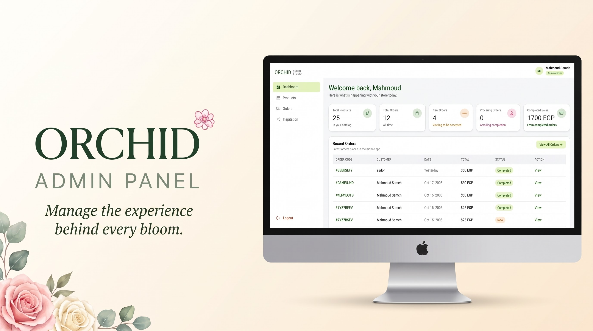

<p align="center">
  
</p>

<h1 align="center">🌸 Orchid Admin Dashboard</h1>

<p align="center">
  <strong>Manage Smarter. Stay Organized. Grow Orchid.</strong><br />
  A modern administrative dashboard built with Flutter Web and Supabase for the Orchid flower ordering platform.
</p>

<p align="center">
  
  
  
  
  
</p>

---

## 🌷 Overview

**Orchid Admin Dashboard** is the administrative web application within the Orchid platform. It provides an interface for authorized administrators to manage and monitor the platform's operational data.

Built with **Flutter Web** and integrated with **Supabase**, the dashboard shares the Orchid ecosystem's backend while maintaining a separate interface tailored to administrative workflows.

The project is maintained in the Orchid monorepo alongside Orchid Mobile and Orchid Web.

### 🎯 Project Goals

- Provide a centralized interface for administrative tasks.
- Organize platform data through dedicated features.
- Connect the dashboard to Supabase services.
- Maintain a consistent and responsive web interface.
- Keep the codebase modular and maintainable.
- Support independent deployment through Vercel.

## ✨ Features

### 🛠️ Administrative Interface
- Dedicated web application for platform administration.
- Feature-oriented screens and reusable UI components.
- Structured navigation and organized administrative workflows.
- Layouts designed for desktop and browser-based use.

### 🌸 Inspiration Management
- Dedicated inspiration-related feature organization.
- Repository and model layers for inspiration data.
- Integration with the configured backend for supported operations.

### 🗄️ Backend Integration
- Supabase client initialization.
- Compile-time configuration through Dart environment definitions.
- Backend communication through the application's configured data-access layer.

### 🖥️ Web Deployment
- Flutter Web release builds.
- Dedicated Vercel project.
- Build-time environment variable configuration.
- Deployment independent of the customer-facing applications.

> The exact availability of user management, product CRUD, order processing, analytics, and other administrative operations depends on the current implementation. Only document those workflows as completed when they are present in the application.

## 🧰 Tech Stack

| Technology | Purpose |
| ---------- | ------- |
| **Flutter Web** | Administrative user interface |
| **Dart** | Application programming language |
| **Supabase** | Backend services and data access |
| **PostgreSQL** | Relational database managed through Supabase |
| **Vercel** | Web hosting and deployment |
| **Git & GitHub** | Source control and collaboration |

## 🏗️ Architecture

The dashboard uses Flutter for its interface and Supabase for backend connectivity. Feature-specific code helps separate models, data-access logic, and presentation responsibilities.

A representative structure:

```text
orchid_admin/
├── lib/
│   ├── main.dart
│   ├── app/
│   ├── core/
│   │   ├── constants/
│   │   ├── responsive/
│   │   └── theme/
│   └── features/
│       └── inspiration/
│           ├── data/
│           │   └── repositories/
│           └── domain/
│               └── models/
│
├── web/
├── assets/
├── test/
├── build.sh
├── pubspec.yaml
└── README.md
```

> This is an illustrative structure based on the known feature organization. Additional folders may exist in the repository.

### Application Configuration
The application reads its Supabase connection details through compile-time environment variables:
- `SUPABASE_URL`
- `SUPABASE_ANON_KEY`

The values are supplied when the application is built, rather than being hardcoded in the application source.

## ⚙️ Getting Started

### Prerequisites

Install the following tools:
- [Flutter SDK](https://docs.flutter.dev/get-started/install)
- [Dart SDK](https://dart.dev/get-dart) compatible with the Flutter version used by the project
- Google Chrome or another supported browser
- Git
- Access to a configured Supabase project

### 1. Clone the Repository

Orchid Admin is part of the Orchid monorepo:

```bash
git clone https://github.com/20Mahmoud06/orchid.git
cd orchid/orchid_admin
```

### 2. Install Dependencies

```bash
flutter pub get
```

### 3. Configure Supabase

Supply the Supabase project URL and publishable key when running the application locally.

```bash
flutter run -d chrome \
  --web-port 8080 \
  --dart-define=SUPABASE_URL=YOUR_SUPABASE_URL \
  --dart-define=SUPABASE_ANON_KEY=YOUR_SUPABASE_PUBLISHABLE_KEY
```

Replace the placeholders with the values for your own Supabase project.

> **Important:** The environment variable names must match the names expected by the application. If the project uses a different configuration mechanism, follow that implementation.

### 4. Run the Dashboard

Once the dependencies and configuration are ready:

```bash
flutter run -d chrome
```

To list available Flutter devices:

```bash
flutter devices
```

If the application requires the Supabase variables to initialize successfully, include the `--dart-define` arguments when launching it.

## 🧪 Testing & Code Quality

Run static analysis:

```bash
flutter analyze
```

Run automated tests:

```bash
flutter test
```

These commands help identify static issues and execute the tests included in the project.

## 🏗️ Production Build

Build the optimized web application:

```bash
flutter build web --release \
  --dart-define=SUPABASE_URL=YOUR_SUPABASE_URL \
  --dart-define=SUPABASE_ANON_KEY=YOUR_SUPABASE_PUBLISHABLE_KEY
```

The generated production files are written to:

```text
build/web/
```

The environment variables must be supplied at build time if the application depends on them.

## 🚀 Deployment with Vercel

Orchid Admin is deployed independently from the other applications in the monorepo.

### Vercel Project Configuration

| Setting | Value |
| ------- | ----- |
| **Git Repository** | 20Mahmoud06/orchid |
| **Root Directory** | orchid_admin |
| **Framework Preset** | Other |
| **Build Command** | `bash build.sh` |
| **Output Directory** | `build/web` |
| **Install Command** | *Leave blank* |

### Environment Variables

Configure the following variables in the Vercel project's environment settings:

| Variable | Description |
| -------- | ----------- |
| `SUPABASE_URL` | URL of the Supabase project |
| `SUPABASE_ANON_KEY` | Client-safe Supabase publishable key |

Use the correct values for the intended deployment environment. Keep these variables in Vercel's environment configuration rather than hardcoding them in `build.sh` or committing them to Git.

### Deployment Workflow

When the Vercel project is connected to the GitHub repository, a push to its configured production branch can trigger a new deployment.

From the monorepo root, stage and commit the relevant changes:

```bash
git add orchid_admin/
git commit -m "update: improve admin dashboard"
git push origin main
```

After pushing:
1. Open the Orchid Admin project in Vercel.
2. Check the latest deployment and build logs.
3. Wait for the build to complete successfully.
4. Open the deployed dashboard and verify its behavior.
5. Confirm that the required environment variables are configured for the target environment.

## 🔐 Security

Administrative applications require careful authorization and data protection.

- Never expose Supabase `service_role` or `sb_secret_` keys in browser code.
- Use only client-safe publishable keys in the Flutter Web application.
- Apply appropriate Row Level Security (RLS) policies to exposed database tables.
- Enforce administrator permissions on the backend, not only in the UI.
- Protect privileged operations with trusted server-side authorization.
- Avoid committing credentials or sensitive configuration files.
- Test access controls using both authorized and unauthorized accounts.

> **Important:** Hiding an admin screen or restricting navigation in Flutter does not provide sufficient security by itself. The backend must independently verify permissions for every privileged operation.

## 🌍 Part of the Orchid Platform

Orchid Admin is one of three applications in the Orchid ecosystem:

- 📱 **Orchid Mobile** — The customer-facing mobile application.
- 🌐 **Orchid Web** — The customer-facing web experience.
- 🛠️ **Orchid Admin** — The administrative dashboard.

Explore the complete project:

[Orchid — GitHub Repository](https://github.com/20Mahmoud06/orchid)

## 👨‍💻 Author

**Mahmoud Safa**

<p>
  <a href="https://github.com/20Mahmoud06">
    
  </a>
  <a href="https://linktr.ee/mahmoudsafa220">
    
  </a>
</p>

---

<p align="center">
  Built with 💜 using Flutter and Supabase.<br />
  <strong>Orchid Admin — Keep every detail in bloom.</strong>
</p>
